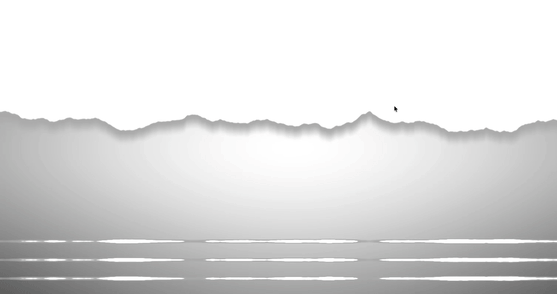
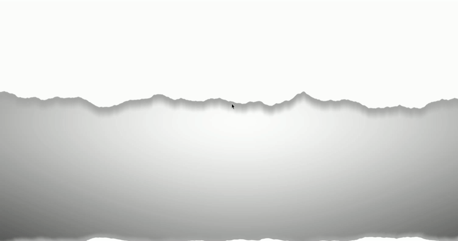
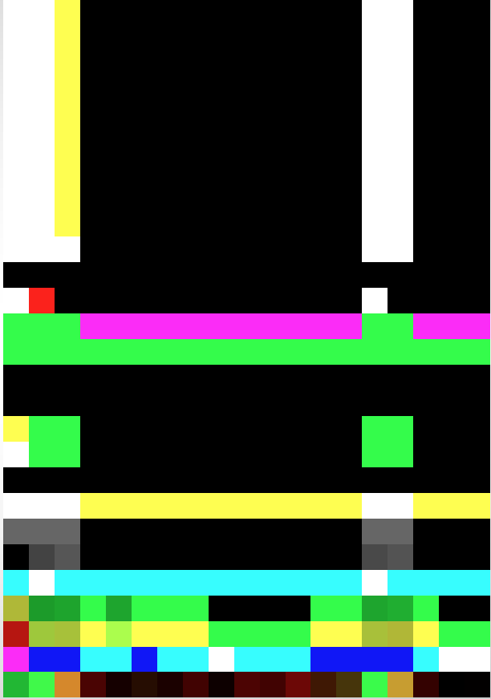
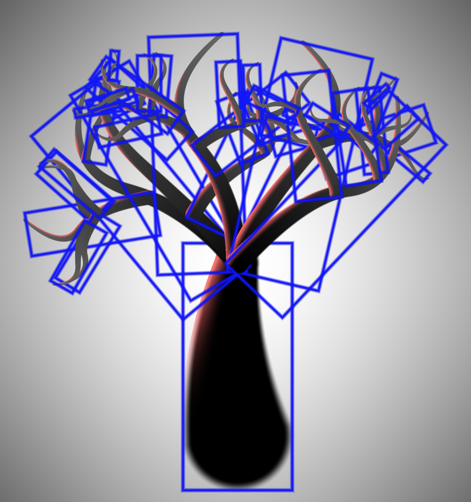
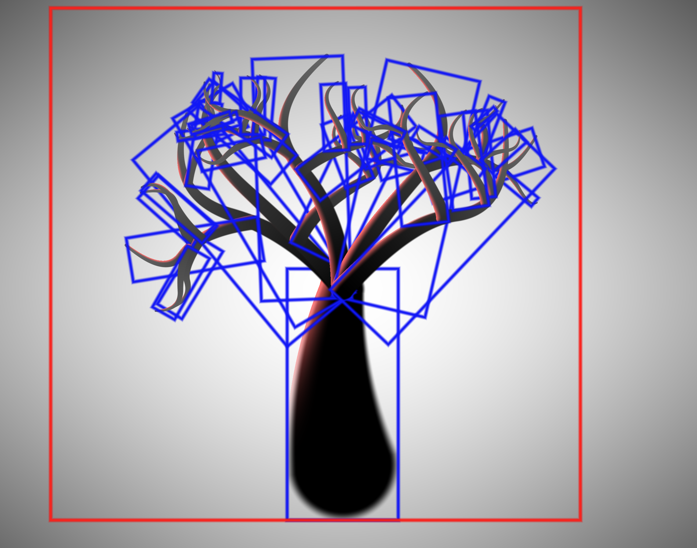
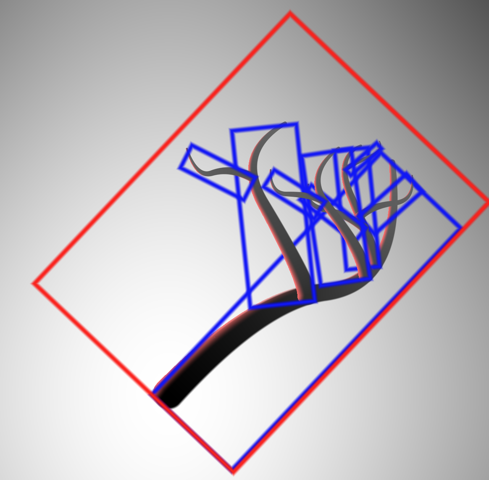
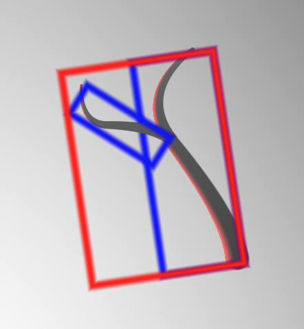

### Before Optimization

Build tree structure in fragment shader, check each fragment with all branches sdf.

### After Optimization

Build tree outside the shader and save the tree structure in a data texture. Build up bounding box hierarchy to check the fragments in the bounding box.

#### Data texture

#### Bounding boxes

#### Bounding box hierarchy
| level 1 | level 2| level 3|
| --------- | --------- | --------- |
| | | 
